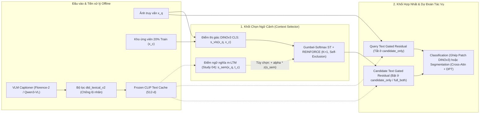

# CẨM NANG TOÀN BỘ HỆ THỐNG TACS & M-TACS

> **Mục đích tài liệu:** Cẩm nang định hướng toàn diện dành cho thành viên mới tiếp cận dự án `TACS/`. Đọc xong tài liệu này, bạn sẽ nắm được: **(1)** kiến thức nền tảng cần biết, **(2)** cấu trúc mã nguồn, **(3)** lộ trình phát triển từ bài báo TACS gốc sang M-TACS đa phương thức và ứng dụng Web, **(4)** toàn bộ điểm số thực nghiệm đã xác minh, **(5)** các kỹ thuật tối ưu hệ thống thực chiến, và **(6)** ranh giới rõ ràng giữa phần đã đo đạc, phần mới có mã nguồn và phần đề xuất tương lai.
>
> **Nguyên tắc biên soạn:** 100% thông tin và con số dưới đây được trích xuất từ mã nguồn, báo cáo kiểm toán và log/output lưu trữ thực tế trong kho mã `TACS/` tính đến tháng 10/2026; mục 5.6 và mục 7 được bổ sung ngày 11/11/2026 từ các notebook và web bundle tháng 11. Không suy diễn hay làm tròn thành tuyên bố vượt quá bằng chứng thực nghiệm.

---

## 1. Tổng quan Dự án: TACS và M-TACS giải quyết bài toán gì?

Trong thị giác máy tính hiện đại, bên cạnh ảnh truy vấn cần dự đoán $x_q$ (*query image*), mô hình có thể tham khảo thêm một ảnh ngữ cảnh $x_c$ (*in-context example*) rút ra từ kho ứng viên huấn luyện $\mathcal{C}$ để phân biệt các chi tiết tinh vi (họa tiết bề mặt, dòng xe, khung cảnh, ranh giới tổn thương y sinh).

Tuy nhiên, cách chọn ngữ cảnh truyền thống dùng độ tương đồng đặc trưng đóng băng (**Frozen DINO kNN**) mắc một nhược điểm lớn: **ảnh giống ảnh truy vấn nhất về mặt thị giác chưa chắc là ảnh giúp bộ phân loại/phân đoạn giảm sai số nhiều nhất**.

Dự án này gồm hai tầng phát triển nối tiếp nhau:

1. **TACS gốc (*Task-Aligned Context Selection*, Guo et al., CVPR 2026):** Học một mạng chọn ngữ cảnh (*Context Selector*) đồng thời với mô hình tác vụ xuôi dòng (*Downstream Task Model*). Thay vì chọn ảnh giống nhất, Selector được thưởng trực tiếp khi ảnh ngữ cảnh nó chọn làm **giảm hàm mất mát của tác vụ chính** so với khi không có ngữ cảnh.
2. **M-TACS (*Multimodal Task-Aligned Context Selection* — nhánh mở rộng của dự án):** Khảo sát việc bổ sung **ngữ cảnh văn bản (caption mô tả thuộc tính thị giác)** từ các mô hình thị giác–ngôn ngữ (Florence-2, Qwen3-VL) mã hóa qua CLIP vào ba khâu: chọn ứng viên, hợp nhất đặc trưng ảnh truy vấn, và hợp nhất đặc trưng ảnh ứng viên — trên cả bài toán **phân loại kết cấu/khung cảnh (DTD, SUN397)** và **phân đoạn ảnh y sinh (ISIC 2017)**, đồng thời đóng gói thành **hệ thống suy luận Web tự chứa**.

---

## 2. Kiến thức Nền tảng Cần Nắm Trước Khi Đọc Code

### 2.1 Cơ chế cốt lõi của bài báo TACS gốc (CVPR 2026)

Để đọc hiểu code trong dự án, người mới cần nắm 5 thành phần toán học và thiết kế của bài báo gốc (`docs/paper/18. Guo_Learning_What_Helps_Task-Aligned_Context_Selection_for_Vision_Tasks_CVPR_2026_paper.pdf`):

1. **Kho ứng viên cố định 20% & Quy tắc loại trừ chính mình (*Self-Exclusion*):**
   - Chỉ lấy cố định **20% tập train** làm kho ứng viên $\mathcal{C}$ (giữ nguyên ở cả pha train, val và test).
   - Khi huấn luyện trên một ảnh $x_q \in \text{train}$, nếu $x_q$ nằm trong $\mathcal{C}$ (hoặc cùng bệnh nhân trong ảnh y sinh), mô hình bắt buộc gán điểm $-\infty$ cho ứng viên đó để tránh rò rỉ đáp án tầm thường.
   - Mặc định mỗi ảnh truy vấn chỉ chọn **$K = 1$** ảnh ngữ cảnh.

2. **Mạng chọn ngữ cảnh (*Selector*) và Điểm tương hợp:**
   - Trích xuất đặc trưng toàn cục (CLS token hoặc trung bình token) từ backbone thị giác **DINOv3**, chiếu qua mạng MLP nhẹ $g_\phi$ để tính điểm logit $s_j = \text{sim}(z_q, z_{c,j})$ giữa truy vấn $x_q$ và mọi ứng viên $x_c^j \in \mathcal{C}$.

3. **Tối ưu hóa lai (*Hybrid Optimization*):**
   Vì phép chọn rời rạc $\arg\max$ không khả vi, TACS kết hợp hai luồng tín hiệu huấn luyện:
   $$\mathcal{L}_{\text{TACS}} = \mathcal{L}_{\text{grad}} + \lambda \mathcal{L}_{\text{policy}} \quad (\lambda = 1.0)$$
   - **Nhánh khả vi $\mathcal{L}_{\text{grad}}$ (*Gumbel-Softmax Straight-Through*, nhiệt độ $\tau = 0.1$):** Lượt truyền xuôi (*forward*) lấy one-hot cứng đúng 1 ảnh ứng viên; lượt truyền ngược (*backward*) truyền đạo hàm qua phân phối mềm Gumbel-Softmax để cập nhật trực tiếp cả mô hình tác vụ và Selector.
   - **Nhánh chính sách $\mathcal{L}_{\text{policy}}$ (*REINFORCE Categorical Policy*):** Lấy mẫu chỉ số $a \sim \text{Categorical}(\pi_\theta(\cdot \mid x_q))$ và tối ưu kỳ vọng phần thưởng đã chuẩn hóa theo batch (*batch-standardized detached reward*):
     $$r(x_q, a) = \mathcal{L}_{\text{task}}\big(f_d(x_q, \emptyset), y\big) - \mathcal{L}_{\text{task}}\big(f_d(x_q, x_c^a), y\big)$$
     Nếu dùng ảnh ứng viên $x_c^a$ làm loss thấp hơn so với không dùng ngữ cảnh ($\emptyset$), phần thưởng $r > 0$ sẽ củng cố xác suất chọn ứng viên đó.

4. **Khác biệt kiến trúc hợp nhất giữa Phân loại và Phân đoạn:**
   - **Classification (CUB, Cars, SUN397, DTD):** Ghép nối chuỗi (*sequence concatenation*) các patch embeddings của $x_q$ và $x_c$ trước khi đi qua các khối Transformer của DINOv3; **fine-tune toàn bộ mạng**.
   - **Segmentation (ISIC 2017, DRIVE, Kvasir-SEG):** **Đóng băng backbone DINOv3**, chèn các khối **Gated Cross-Attention** để token ảnh truy vấn lấy thông tin từ token ảnh ngữ cảnh, sau đó giải mã mặt nạ phân đoạn bằng đầu **DPT nhẹ**.

5. **Phát hiện khoa học quan trọng nhất của Paper (Figure 3 & 4):**
   TACS không chọn ảnh bản sao giống hệt ảnh truy vấn. Nó có tỷ lệ chọn ảnh **khác lớp (cross-class) cao hơn 40%–70%** và độ đa dạng cảm nhận (LPIPS) cao hơn hẳn Frozen DINO — tức học cách chọn ví dụ **tương phản hoặc bổ trợ đặc trưng phân biệt**.

### 2.2 Các khối công nghệ bổ sung trong nhánh mở rộng M-TACS

| Thành phần | Công nghệ sử dụng trong repo | Vai trò cụ thể trong M-TACS |
| :--- | :--- | :--- |
| **Visual Backbone** | `DINOv3` (`ViT-S/16` 384-d, `ViT-B/16` 768-d, `ViT-L/16` 1024-d) | Trích xuất đặc trưng thị giác cho cả truy vấn, kho ứng viên và tác vụ xuôi dòng. |
| **VLM sinh Caption** | `Florence-2-base` (0.23B) & `Qwen3-VL-8B/32B-Instruct` | Sinh câu mô tả ngắn (5–8 từ) về thuộc tính bề mặt/khung cảnh/tổn thương từ ảnh gốc. |
| **Text Encoder** | `CLIP ViT-B/32` đóng băng (512-d) | Biểu diễn câu caption hợp lệ thành vector ngữ nghĩa cố định `text_embeddings.pt`. |
| **Gated Residual Fusion** | MLP chiếu `512 -> D` + cổng học `tanh(gate)` khởi tạo `0` | Cộng phần dư văn bản vào đặc trưng ảnh $z' = \text{LN}(z_{\text{img}} + \tanh(g)\cdot m \cdot z_{\text{txt}})$ an toàn, không phá hủy đặc trưng thị giác ban đầu. |
| **Decoder LoRA** | Low-Rank Adaptation ($r=8, \alpha=16$) trên decoder Florence-2 | Thử nghiệm tinh chỉnh nhẹ bộ sinh caption trên tập tham chiếu nhỏ mà không cập nhật toàn bộ trọng số VLM. |
| **m-LTM Sinkhorn OT** | Balanced Log-Sinkhorn Optimal Transport + metric đường chéo Mahalanobis | Căn chỉnh không gian đặc trưng ảnh DINO và caption CLIP trên kho ứng viên trước khi đưa vào Selector. |

### 2.3 Bảng chống nhầm lẫn thuật ngữ (Đọc kỹ trước khi xem kết quả!)

> [!IMPORTANT]
> Rất nhiều nhầm lẫn khi đọc code hoặc viết báo cáo xuất phát từ 4 cặp khái niệm dưới đây:
> 1. **`No-Context` (Paper) ≠ `visual_only` (Chuỗi DTD Ablation):** `No-Context` của bài báo hoàn toàn không dùng ảnh ngữ cảnh nào. Ngược lại, `visual_only` trong chuỗi DTD M-TACS **vẫn là mô hình TACS có chọn 1 ảnh ngữ cảnh thị giác**, chỉ tắt hoàn toàn kênh văn bản (`gate = 0`).
> 2. **`K = 1` ≠ `DTD_SPLIT = 1` ≠ `SEED = 42`:** `K = 1` là số ảnh ngữ cảnh chọn cho mỗi ảnh truy vấn; `DTD_SPLIT = 1` là bản chia train/val/test chính thức số 1 của bộ dữ liệu DTD; `SEED = 42` là hạt giống ngẫu nhiên của lượt huấn luyện.
> 3. **Thước đo của Paper (`Top-1 Accuracy`) ≠ Thước đo chính chuỗi DTD (`Macro-F1`):** Trên DTD split 1 (cân bằng mỗi lớp đúng 40 ảnh test), Accuracy và Macro-F1 xấp xỉ nhau nhưng không đồng nhất; luôn phải ghi rõ tên metric khi trích dẫn.
> 4. **`caption_references.csv` (188 ảnh DTD) không phải nhãn người gán thủ công:** Đây là bộ caption mục tiêu ngắn do AI biên soạn theo quy tắc mô tả bề mặt (`AI-teacher annotations`), dùng để thử nghiệm pipeline LoRA.

---

## 3. Bản đồ Cấu trúc Hệ thống `TACS/` & Lưu ý Lịch sử

Kho mã `TACS/` được chuẩn hóa và di trú bảo toàn byte từ thư mục nghiên cứu ban đầu sang cấu trúc phân tách rõ ràng giữa tài liệu, mã tái sử dụng, notebook thực nghiệm và bằng chứng kết quả:

```text
TACS/
├── apps/sun397_demo/        # Ứng dụng Web FastAPI: đối chiếu TACS Visual vs M-TACS trên SUN397 + trang phân đoạn ISIC (isic_*.py, isic/)
├── artifacts/               # Nơi đặt model bundle cho web & các checkpoint lịch sử (imported_unverified)
├── configs/                 # Mẫu cấu hình đường dẫn cục bộ (paths.local.example.json) & prompt SUN397
├── data/
│   ├── annotations/dtd/     # 188 mẫu caption_references.csv (AI-teacher) + ghi chú biên soạn
│   └── captions/dtd/        # Các bộ caption DTD đã kiểm toán (Prefix, Grounded, Qwen 8B/32B) + manifest SHA-256
├── docs/                    # Nguồn sự thật về giao thức, hướng dẫn chạy, lịch sử dự án & bài báo CVPR 2026
├── experiments/completed/   # Nơi lưu trữ notebook ĐÃ CHẠY XONG có khóa output (Chuỗi A: 8 ablation, Chuỗi C: 6 caption)
├── manifests/               # Danh mục kiểm kê notebook, ánh xạ đường dẫn di trú & kết quả regression test
├── notebooks/
│   ├── 01_paper_reproduction/ # Tái lập TACS thị giác theo bài báo (CUB-200, Stanford Cars, SUN397, ISIC 2017)
│   ├── 02_improvements/       # Khuôn mẫu notebook M-TACS (captioning, role ablation, architecture study, ISIC seg)
│   ├── 03_figures_and_analysis/ # Notebook vẽ hình minh họa chọn ngữ cảnh (Figure 4)
│   ├── 04_deployment/         # Pipeline huấn luyện + đóng gói model bundle (.zip) cho Web SUN397 (TACS & M-TACS)
│   └── 90_archive/            # Kho lưu trữ lịch sử (chỉ giữ để tra cứu nguồn gốc, không dùng cho báo cáo mới)
├── reports/                 # Báo cáo đối chiếu kết quả, bảng chuẩn hóa bài báo & dữ liệu kiểm toán JSON
├── src/
│   ├── captioning/          # Bộ lọc dtd_lexical_v2, grounded caption, Qwen/Florence runner, caption web SUN397
│   ├── models/              # Kiến trúc TACSVisualWebModel & MTACSMultimodalWebModel phục vụ đóng gói/suy luận
│   └── training/            # Các cell huấn luyện DTD (ablation, norm-fusion, m-LTM, semantic selector), ISIC & bản vá OOM SUN397
├── tests/                   # 38 file kiểm thử tự động (pytest) bảo vệ giao thức, bộ lọc caption, builder & web bundle
└── tools/                   # Trình sinh notebook tự động (notebook_builders/), script kiểm toán (audit_*.py) & xuất Word
```

**Lưu ý thêm về các file thực thi đặt tại thư mục gốc `TACS/`:**
Trong quá trình tải kết quả từ Kaggle về máy cục bộ, một số bản chạy hoàn chỉnh nằm trực tiếp ở gốc `TACS/`:
- Chuỗi kiến trúc DTD: `dtd-architecture-study-01.ipynb` (`S01`), `stydu2_da_train.ipynb` (`S02`), `study3_datrain.ipynb` (`S03`). Bản `S04` (trước là `study4.ipynb` ở gốc) đã được chuyển ngày 04/11/2026 sang `notebooks/02_improvements/multimodal_architecture_ablation/04_candidate_only_semantic_selector/dtd/study04-dtd-prefix-aligned-image-caption-selector-executed.ipynb` (xem `notebooks/IMPORTS_2026-11-04.md`).
- Chuỗi phân đoạn ISIC 2017: `tacs_isic_segement_448.ipynb` (`I01` Visual), `isic-segmen-captions.ipynb` (`I02` Qwen3-VL-8B).
- File `tacs_web.ipynb` ở gốc hiện là bản notebook đã vá lỗi bộ nhớ nhưng **chưa có output chạy GPU**.

> [!WARNING]
> **Cảnh báo các tên file lịch sử dễ gây hiểu nhầm (đã được kiểm toán trong `manifests/notebook_catalog.json`):**
> - `notebooks/01_paper_reproduction/classification/sun397/baseline_no_tacs_cars.ipynb` → Tên ghi `cars` nhưng bên trong thực chất cấu hình chạy **SUN397**.
> - `notebooks/01_paper_reproduction/classification/stanford_cars/tacs-chuanpaper-sun-b16 (2).ipynb` → Tên ghi `sun` nhưng thực chất huấn luyện **Stanford Cars** (`ViT-B/16`, `384x384`).
> - `notebooks/90_archive/SUN/table2/ban-cuoi-frozen-dino-car.ipynb` → Tên ghi `frozen-dino` nhưng thực chất chạy **TACS có học (shortlist-4)** trên Stanford Cars.
> - Các file `.pt` trong `artifacts/checkpoints/imported_unverified/` là bản sao lịch sử trùng SHA-256 giữa hai nhánh cũ, chỉ giữ lưu trữ cho tới khi xác minh khớp cấu hình kiến trúc.

---

## 4. Từ Cái Cũ Áp Dụng Cái Mới: Hành trình Tiến hóa Hệ thống

Sơ đồ dưới đây tóm tắt cách dự án mở rộng từ kiến trúc TACS thuần thị giác sang kiến trúc đa phương thức M-TACS có kiểm soát:



Toàn bộ lịch sử nghiên cứu của dự án đi qua **6 bước tiến hóa nhân quả**, trong đó mỗi bước mới ra đời để giải quyết đúng hạn chế phát hiện ở bước trước:

### Bước 1 — Tái lập TACS thuần thị giác (Thế hệ nền tảng)
- Triển khai cơ chế chọn ngữ cảnh TACS và các baseline (`No-Context`, `Random`, `Frozen DINO`) trên **CUB-200-2011**, **Stanford Cars**, **SUN397** và mở rộng sang phân đoạn tổn thương da **ISIC 2017** ở độ phân giải `448x448` với 2 khối Gated Cross-Attention cuối backbone DINOv3 `ViT-S/16` kết hợp `DPTLiteHead`.

### Bước 2 — Đưa văn bản vào M-TACS & Cải tổ bộ lọc `dtd_lexical_v2`
- **Vấn đề ở bản đầu tiên:** Pipeline cũ dùng câu mở đầu thô của Florence-2 và áp ngưỡng cứng độ tương đồng CLIP với tên lớp `>= 0.30` để chống lộ nhãn. Trên bộ dữ liệu kết cấu DTD, từ vựng mô tả họa tiết tự nhiên rất gần tên lớp trong không gian CLIP khiến bộ lọc **loại nhầm gần 100% caption**, trong khi các câu sống sót lại chứa cụm sáo rỗng (*"The image is a close up of..."*).
- **Giải pháp mới (`src/captioning/dtd_caption_screening.py` — chính sách `dtd_lexical_v2`):**
  1. Cắt bỏ tiền tố mở đầu chung chung, chuẩn hóa câu ngắn gọn **5–8 từ** chỉ mô tả hình học, mật độ, màu sắc bề mặt.
  2. Chặn trực tiếp **từ vựng tên lớp và từ đồng nghĩa hình thái** (*lexical leakage blocker*).
  3. Hạ điểm tương đồng CLIP `>= 0.30` xuống vai trò **chỉ số kiểm toán (audit)** thay vì loại cứng.
  4. **Cơ chế an toàn không làm rơi mẫu:** Ảnh có caption không đạt chuẩn **không bị xóa khỏi tập train/val/test hay pool**; thay vào đó nó nhận vector `0` và mặt nạ `valid_mask = False` (cổng văn bản tự động bằng `0`).

### Bước 3 — Chuỗi A: Tách bạch vai trò văn bản trên DTD (`experiments/completed/text_context_ablation/dtd/`)
- Thay vì chỉ chạy một mô hình M-TACS tổng hợp, nhóm thiết kế 8 thực nghiệm đối chứng trên cùng DTD split 1 (`DINOv3 ViT-L/16`, `384x384`, 50 epochs, seed 42) để trả lời: *Văn bản đặt ở đâu thì giúp, đặt ở đâu thì hại?*
- **Phát hiện bước ngoặt:** Đưa caption vào phía ảnh truy vấn (`query_only`: `82.31%` F1; `full_both`: `80.91%` F1) làm giảm mạnh hiệu năng so với chuẩn đối chứng TACS thị giác (`visual_only`: `84.82%` F1). Kể cả khi xáo trộn ngẫu nhiên caption giữa các ảnh (`full_shuffle_both`: `83.34%` F1), mô hình còn đạt điểm cao hơn `full_both` vì học cách dập cổng văn bản nhiễu. Chỉ duy nhất cấu hình **chỉ gắn caption cho ứng viên (`candidate_only`: `85.03%` F1)** không làm hỏng mô hình và nhỉnh nhẹ `+0.22` điểm % trên tập test.

### Bước 4 — Chuỗi C: Nâng cấp nguồn sinh Caption trên `full_both` (`experiments/completed/caption_ablation/dtd/`)
- Đặt giả thuyết rằng `full_both` kém là do Florence-2 sinh câu mô tả yếu hoặc tỉ lệ câu bị lọc bỏ cao, nhóm giữ nguyên mô hình `full_both` và thử 7 phương án caption mới:
  1. Tinh chỉnh **Decoder-LoRA** cho Florence-2 trên 188 mẫu tham chiếu (`caption_references.csv`).
  2. Bốn chế độ hậu xử lý/chọn câu từ Florence-2 đóng băng: `Prefix`, `FirstValid` (lấy câu hợp lệ đầu tiên, phủ 100%), `SingleGrounded` và `MultiGrounded` (dùng CLIP chấm điểm đối chiếu vùng ảnh để chọn mệnh đề).
  3. Thay hẳn VLM bằng **`Qwen3-VL-8B-Instruct`** và **`Qwen3-VL-32B-Instruct`**.
- **Kết quả:** Qwen3-VL-8B (`82.14%` F1) và 32B (`82.08%` F1) vượt mọi phương pháp Florence trên `full_both` hơn `+1.0` điểm %, chứng tỏ chất lượng mô tả thuộc tính của VLM lớn có tác dụng thật. Tuy nhiên, cả hai vẫn thấp hơn `visual_only` (`84.82%`), và việc ép độ phủ lên 100% bằng CLIP rerank (`SingleGrounded`/`MultiGrounded`) lại kéo giảm điểm do đưa thêm câu kém đặc trưng vào. Điều này chứng minh **nút thắt chính nằm ở kiến trúc hợp nhất đa phương thức chứ không đơn thuần ở bộ sinh caption**.

### Bước 5 — Chuỗi S: Giải phẫu kiến trúc hợp nhất & bộ chọn trên `candidate_only`
Khóa cố định file caption `captions_prefix_control.csv` bằng mã băm SHA-256 trên cấu hình tốt nhất `candidate_only`, nhóm tiến hành 4 bước can thiệp kiến trúc tuần tự (`S01` → `S04`):
- **`S01` Baseline (`dtd-architecture-study-01.ipynb`):** Phát hiện lý do cổng văn bản `mean_c_gate` chỉ đạt `~0.0011`: vector đặc trưng thị giác đã chuẩn hóa đơn vị (`norm = 1`), trong khi vector văn bản sau lớp chiếu tuyến tính có chuẩn lớn gấp `~32` lần (`norm ~ 32`), buộc mô hình phải giữ cổng cực nhỏ để không làm nổ biên độ.
- **`S02` Norm-Calibrated Fusion (`stydu2_da_train.ipynb`):** Chuẩn hóa L2 vector văn bản đã chiếu trước khi nhân với cổng phần dư. Cổng `mean_c_gate` lập tức mở lên `~0.0624` (tăng hơn 55 lần). Tuy nhiên, bài kiểm tra can thiệp trên cùng checkpoint cho thấy tắt văn bản (`text_off`) hoặc tráo văn bản (`text_shuffled`) trên tập val không làm giảm Macro-F1 (dù `aligned` có CE loss thấp hơn) — nghĩa là phép cộng phần dư ở cấp vector toàn cục vẫn chưa tạo ra đặc trưng phân lớp vượt trội.
- **`S03` Auxiliary m-LTM Alignment (`study3_datrain.ipynb`):** Bổ sung hàm mất mát phụ **Optimal Transport cân bằng (log-Sinkhorn KL, trọng số `0.05`)** với metric đường chéo Mahalanobis dương (`+1,024` tham số) và gom nhóm các caption trùng nhau trên kho ứng viên. Không gian chung học rất tốt trên pool (caption-group top-1 đạt `74.69%`, KL giảm từ `3.41` xuống `0.859`), nhưng nếu chỉ dùng làm loss phụ cho nhánh fusion thì Test F1 (`84.87%`) vẫn đi ngang so với `S02` (`84.93%`).
- **`S04` Aligned Semantic Selector (`study04-dtd-prefix-aligned-image-caption-selector-executed.ipynb`):** Tận dụng trực tiếp không gian căn chỉnh m-LTM của `S03` để chấm điểm **ảnh truy vấn DINO CLS với caption ứng viên CLIP** ngay bên trong **Selector**:
  $$s_{\text{total}}(x_q, x_c^j) = z_{\text{vis}}(x_q, x_c^j) + \alpha \cdot \text{clip}\big(z_{\text{masked}}(s_{\text{sem}}(x_q, t_c^j)), -3, 3\big), \quad \alpha \in [0, 0.25]$$
  Với lịch khởi động 5 epoch đầu thuần thị giác + 5 epoch tăng dần, trọng số học được hội tụ ở $\alpha \approx 0.131$, kéo kết quả phục hồi lên **`85.16%` Acc / `85.07%` F1** (vượt qua cả `S02` và `S03`). Đặc biệt, phép thử can thiệp Selector xác nhận khi tắt hoặc tráo caption trong Selector, `5.21%–10.59%` truy vấn bị đổi ảnh ngữ cảnh và cả Val F1 lẫn Val Loss đều suy giảm nhẹ — lần đầu tiên chứng minh **Selector thực sự khai thác tín hiệu ngữ nghĩa của caption ứng viên**.

### Bước 6 — Mở rộng sang Phân đoạn Y sinh ISIC 2017 & Đóng gói Web SUN397
- **ISIC 2017 (`isic-segmen-captions.ipynb`):** Xây dựng chính sách lọc thuộc tính da liễu `isic_visible_attributes_v1` (mô tả màu sắc, đường viền, cấu trúc bề mặt nhìn thấy được, cấm hoàn toàn thuật ngữ chẩn đoán bệnh lý như *melanoma/nevus*, đạt độ phủ hợp lệ **100%** trên `2,750` ảnh với Qwen3-VL-8B) và tích hợp vào mô hình phân đoạn `448x448`.
- **Triển khai Web SUN397 (`notebooks/04_deployment/` & `apps/sun397_demo/`):** Thiết kế kiến trúc mô hình đóng gói độc lập (`TACSVisualWebModel`, `MTACSMultimodalWebModel`) xuất ra một gói `.zip` tự chứa toàn bộ checkpoint, mã nguồn DINOv3 vendored, ảnh & đặc trưng kho ứng viên, bản đồ nhiệt chú ý thực (*last-block CLS-to-patch attention*) và tự kiểm tra nạp nguội (*cold-reload verification*) trước khi gắn vào giao diện FastAPI.

### Bước 7 — Nâng backbone lên `ViT-L/16` cho bản Web SUN397 & ISIC 2017 (31/10 – 04/11/2026)
- **SUN397 (31/10):** Huấn luyện bằng engine tiết kiệm bộ nhớ `memory_bounded_two_pass_v2` (batch logic 64 / batch tính toán 8, xem mục 6.4) và xuất hai bundle `sun397_tacs_visual_vitl16_web_bundle.zip` và `sun397_mtacs_full_both_vitl16_web_bundle.zip`.
- **ISIC 2017 (02/11):** Xuất bundle `isic2017_tacs_vitl16_448_web_bundle.zip` (chỉ ảnh) và `isic2017_mtacs_vitl16_448_web_bundle.zip` (M-TACS `full_both`, caption Florence-prefix). Cả hai đều qua smoke test (`state_reload`, `trained_model_parity`, `attention_parity`, `selected_context_parity`, `cold_offline_reload` đều `true`).
- **Web ISIC & giao diện studio (04/11 trở đi):** Thêm `apps/sun397_demo/isic_backend.py`, `isic_worker.py`, `isic_caption_override.py`, trang `apps/sun397_demo/isic/` và `assets/studio.*`. Phần này **chưa commit** vào Git tính đến 11/11/2026.
- Số liệu của cả bốn bundle nằm ở mục 5.6; tất cả **chỉ có điểm val**, chưa chạy test.

---

## 5. Tổng hợp Toàn bộ Điểm số Thực nghiệm Đã Xác minh

### 5.1 Tham chiếu Bài báo CVPR 2026 & Các lượt chạy TACS Thị giác Lịch sử

**Bảng 5.1a — Số liệu gốc trong bài báo TACS (Guo et al., CVPR 2026 — `DINOv3 ViT-S/16`, `256x256`, `K=1`, trung bình 3 seeds):**

| Bộ dữ liệu (Tác vụ) | Metric trong Paper | No-Context | Frozen DINO | TACS (Paper) |
| :--- | :--- | :---: | :---: | :---: |
| **CUB-200-2011** (Phân loại chim, 200 lớp) | Top-1 Acc (%) | 82.1 | 81.4 | **85.2** |
| **DTD** (Phân loại kết cấu, 47 lớp) | Top-1 Acc (%) | 76.1 | 75.4 | **77.7** |
| **Stanford Cars** (Phân loại xe, 196 lớp) | Top-1 Acc (%) | 92.4 | 93.0 | **94.1** |
| **SUN397** (Phân loại khung cảnh, 397 lớp) | Top-1 Acc (%) | 68.0 | 69.2 | **71.8** |
| **ISIC 2017** (Phân đoạn tổn thương da) | Dice / IoU (%) | 83.3 / 74.4 | 84.4 / 76.0 | **85.0 / 76.5** |

**Bảng 5.1b — Các lượt chạy thị giác đã lưu output trong kho mã `TACS/` (Lưu ý: khác nhau về backbone/độ phân giải nên KHÔNG gộp chung thành một bảng ngang hàng nếu chưa chạy lại cùng protocol):**

| Bộ dữ liệu | Phương pháp & Cấu hình thực tế trong Notebook | Độ phân giải | Test Acc (%) | Test Macro-F1 (%) | Ghi chú kiểm toán giao thức |
| :--- | :--- | :---: | :---: | :---: | :--- |
| **CUB-200** | `No-Context` (`ViT-S/16`, 3 seeds: 42 / 43 / 44) | `256x256` | 82.46 / 82.27 / 82.53 | 82.57 / 82.32 / 82.54 | Khớp sát số `82.1%` của paper; chưa chạy nhánh có ngữ cảnh trên CUB. |
| **Stanford Cars** | `No-Context` (`ViT-S/16`, seed 44, full train) | `256x256` | 91.59 | 91.43 | Đánh giá trên checkpoint cuối (không tách val). |
| **Stanford Cars** | `Random Context` (`ViT-S/16`) | `448x448` | 94.38 | 94.29 | Độ phân giải cao hơn paper (`448` vs `256`). *(Một bản `256` khác bị lỗi `1.79%` Acc không dùng).* |
| **Stanford Cars** | `Frozen DINO` (`ViT-S/16`, `K=4`, pool 100%) | `448x448` | 93.60 | 93.45 | Huấn luyện dừng sớm do ngắt phiên, `K=4` và pool 100% khác chuẩn 20%. |
| **Stanford Cars** | `TACS shortlist-4` (`ViT-S/16`) | `448x448` | 94.98 | 94.90 | Lưu trong file tên lịch sử `ban-cuoi-frozen-dino-car.ipynb`. |
| **Stanford Cars** | `TACS` (`ViT-B/16`) | `384x384` | 95.15 | 95.03 | Backbone lớn hơn (`ViT-B/16`); lưu trong `tacs-chuanpaper-sun-b16 (2).ipynb`. |
| **SUN397** | `TACS` (`ViT-S/16`, tách val chuẩn, early stop ep 23) | `256x256` | 74.01 | 73.85 | Cùng cỡ backbone & ảnh với paper (`71.8%`), có tách tập validation thật. |
| **SUN397** | `TACS` (`ViT-B/16`, tách val chuẩn) | `384x384` | 79.42 | 79.27 | Tăng mạnh nhờ nâng cấp lên `ViT-B/16` và ảnh `384x384`. |
| **SUN397** | `M-TACS lịch sử` (`ViT-S/16`, query-caption, cov 60.55%) | `384x384` | 76.12 | 76.02 | Khác độ phân giải với bản `ViT-S/16` `256x256` nên chưa kết luận thuần do caption. |
| **SUN397** | `TACS Adaptive` (`ViT-S/16`, số ngữ cảnh thay đổi theo ảnh, tối đa 3, trung bình ~2) | `384x384` | 75.88 | 75.80 | `notebooks/02_improvements/adaptive_context/sun397/tacs-adaptive-sun.ipynb`; không dùng caption, `K` khác chuẩn `K=1` của paper. |

---

### 5.2 Chuỗi A — 8 Thực nghiệm Tách vai trò Văn bản trên DTD
*Giao thức cố định:* DTD official split 1 (`1,880` train / `1,880` val / `1,880` test, 47 lớp), kho ứng viên `376` ảnh (20% train), `K=1` có self-exclusion, `DINOv3 ViT-L/16`, `384x384`, 50 epochs, `SEED=42`, chọn best checkpoint theo `val CE loss` nhỏ nhất, caption Florence-2 lọc qua `dtd_lexical_v2`. *(Lưu ý kỹ thuật: trong nhánh code DTD, phép chọn ứng viên dùng index gather + REINFORCE policy thay vì nhân ma trận Gumbel ST trực tiếp trên pixel).*

| Mã | Cấu hình (`experiment`) | Query Text | Candidate Text | Selector Text | Best Ep | Val Macro-F1 (%) | Test Acc (%) | Test Macro-F1 (%) | Lệch F1 so với `A01` |
| :---: | :--- | :---: | :---: | :---: | :---: | :---: | :---: | :---: | :---: |
| **A01** | `visual_only` *(TACS Visual đối chứng)* | Tắt | Tắt | Tắt | 38 | **84.66** | 84.95 | 84.82 | `0.00` |
| **A02** | `query_only` | Bật | Tắt | Tắt | 29 | 80.64 | 82.34 | 82.31 | `-2.51` |
| **A03** | `candidate_only` | Tắt | Bật | Tắt | 38 | 83.98 | **85.16** | **85.03** | **`+0.22`** *(+4 ảnh test)* |
| **A04** | `both_fusion` | Bật | Bật | Tắt | 39 | 79.74 | 81.17 | 81.07 | `-3.75` |
| **A05** | `full_both` | Bật | Bật | Bật | 42 | 80.25 | 81.01 | 80.91 | `-3.90` |
| **A06** | `full_shuffle_both` *(Tráo ngẫu nhiên text)* | Tráo | Tráo | Tráo | 21 | 82.75 | 83.40 | 83.34 | `-1.48` *(+2.43 vs A05)* |
| **A07** | `full_unscreened` *(Caption thô 100%)* | Bật | Bật | Bật | 41 | 77.61 | 79.04 | 78.98 | `-5.84` |
| **A08** | `full_redacted` *(Che từ lộ nhãn, phủ 100%)* | Bật | Bật | Bật | 39 | 80.56 | 81.28 | 81.11 | `-3.71` *(+2.13 vs A07)* |

---

### 5.3 Chuỗi C — 8 Phương pháp Sinh & Chọn Caption trên DTD (`full_both`)
*Giao thức cố định:* Giữ nguyên kiến trúc `full_both`, DTD split 1, `DINOv3 ViT-L/16`, `384x384`, 50 epochs, `SEED=42`, `K=1`. Chỉ thay đổi nguồn caption đầu vào.

| Mã | Phương pháp Caption | Caption hợp lệ / 5,640 | Độ phủ Query Test (%) | Val Macro-F1 (%) | Test Acc (%) | Test Macro-F1 (%) | Nhận xét chính |
| :---: | :--- | :---: | :---: | :---: | :---: | :---: | :--- |
| **A05** | Florence-2 cũ (`dtd_lexical_v2`) | 4,749 (84.20%) | 84.63 | 80.25 | 81.01 | 80.91 | Mốc xuất phát `full_both`. |
| **LoRA** | Florence-2 Decoder-LoRA *(188 mẫu AI-teacher)* | 5,361 (95.05%) | 94.52 | 79.68 | 80.74 | 80.67 | Tăng độ phủ hợp lệ nhưng giảm nhẹ `-0.24` điểm % F1. |
| **C01** | `Florence-Prefix` *(Đối chứng chuẩn hóa)* | 4,749 (84.20%) | 84.63 | 80.23 | 81.12 | 81.07 | Tái lập ổn định mốc Florence đóng băng. |
| **C02** | `Florence-FirstValid` *(Câu hợp lệ đầu tiên)* | 5,640 (100.0%) | 100.00 | 80.23 | 81.06 | 80.94 | Đạt phủ 100% không cần rerank, F1 tương đương Prefix. |
| **C03** | `Florence-SingleGrounded` *(CLIP rerank greedy)* | 5,640 (100.0%) | 100.00 | 78.17 | 78.19 | 77.96 | Giảm `-3.10` điểm % F1 vs Prefix do CLIP ưu tiên câu chung chung. |
| **C04** | `Florence-MultiGrounded` *(CLIP rerank + 3 beams)* | 5,640 (100.0%) | 100.00 | 79.02 | 79.31 | 79.06 | Tốt hơn SingleGrounded `+1.10` điểm % nhưng vẫn kém Prefix `-2.01` điểm %. |
| **C05** | **`Qwen3-VL-8B-Instruct`** *(Đóng băng)* | 4,211 (74.66%) | 74.10 | **81.14** | **82.29** | **82.14** | **Tốt nhất trên `full_both`** (`+1.08` điểm % F1 so với `C01`). |
| **C06** | `Qwen3-VL-32B-Instruct` *(Đóng băng)* | 4,111 (72.89%) | 71.60 | 80.92 | 82.18 | 82.08 | Ngang ngửa bản 8B, không cần tốn chi phí suy luận 32B. |

---

### 5.4 Chuỗi S — 4 Nghiên cứu Kiến trúc Đa phương thức trên DTD (`candidate_only`)
*Giao thức cố định:* Khóa cứng `captions_prefix_control.csv` (`SHA-256: b71de4b2...`), chế độ `candidate_only` (tắt hoàn toàn query text), DTD split 1, `DINOv3 ViT-L/16`, `384x384`, 50 epochs, `SEED=42`, `K=1`. Cả 4 mô hình đều đạt best checkpoint tại **epoch 38**.

| Mã | Nghiên cứu Kiến trúc | Thay đổi kỹ thuật cốt lõi | `mean_c_gate` (Test) | Val Macro-F1 (%) | Test Acc (%) | Test Macro-F1 (%) | Chẩn đoán Can thiệp trên Val (cùng Checkpoint) |
| :---: | :--- | :--- | :---: | :---: | :---: | :---: | :--- |
| **S01** | **Baseline Candidate-Only** | Cộng phần dư trực tiếp vector chiếu chưa chuẩn hóa L2 | `0.0011` | **84.02** | **85.43** | **85.30** | Gate cực nhỏ để bù lệch chuẩn (`norm ~ 32` vs `1`). |
| **S02** | **Norm-Calibrated Fusion** | Chuẩn hóa L2 vector văn bản ứng viên trước cổng trộn | `0.0624` | 83.58 | 85.05 | 84.93 | Fusion: `aligned` (`83.58%`) chưa thắng `text_off` (`83.91%`) về F1 dù CE loss thấp hơn. |
| **S03** | **m-LTM Sinkhorn Alignment** | `S02` + loss phụ log-Sinkhorn OT (`w=0.05`) + metric Mahalanobis | `0.0711` | 83.49 | 84.95 | 84.87 | Căn chỉnh tốt trên pool (`74.69%` group top-1), nhưng F1 phân loại tương đương `S02` ($p=0.79$). |
| **S04** | **Aligned Semantic Selector** | `S03` + đưa điểm tương hợp ảnh query–caption ứng viên vào Selector ($\alpha \approx 0.131$) | `0.0701` | 83.88 | 85.16 | 85.07 | **Selector thực sự dùng caption:** tắt/tráo text selector đổi `5.21%–10.59%` ngữ cảnh và làm giảm nhẹ Val F1 (`83.88% -> 83.83% / 83.66%`). |

---

### 5.5 Chuỗi I — Phân đoạn Ảnh Y sinh trên ISIC 2017
*Giao thức cố định:* `2,000` train / `150` val / `600` test, kho ứng viên `400` ảnh (20% train), `K=1` có self-exclusion, đóng băng `DINOv3 ViT-S/16`, độ phân giải `448x448`, 2 khối Gated Cross-Attention ở token lớp cuối + `DPTLiteHead`, hàm mất mát `BCE + Dice`, tối đa 100 epochs (early stopping patience 15), `SEED=42`.

| Mã | Mô hình Phân đoạn | Chính sách / Độ phủ Caption | Best Ep (Stop Ep) | Val Dice (%) | Test Dice (%) | Test IoU (%) | Đối chiếu & Diễn giải |
| :---: | :--- | :--- | :---: | :---: | :---: | :---: | :--- |
| **I01** | **Visual TACS Variant (`448x448`)** | Không dùng văn bản | 49 (64) | 87.31 | **85.60** | **77.38** | Cao hơn con số `85.0% / 76.5%` ở `256x256` của paper, nhưng khác độ phân giải, số tầng cross-attention và chưa có `No-Context 448x448` đối chứng. |
| **I02** | **M-TACS `full_both` + `Qwen3-VL-8B`** | `isic_visible_attributes_v1` (`100%` trên `2,750` ảnh) | 26 (41) | **87.55** | 84.87 | 76.54 | Hội tụ sớm hơn và nhỉnh hơn `+0.24` điểm % trên Val (`150` ảnh), nhưng thấp hơn `-0.73` điểm % Dice / `-0.84` điểm % IoU trên Test (`600` ảnh). |

### 5.6 Chuỗi W — Các bundle Web `DINOv3 ViT-L/16` (tháng 11/2026, CHỈ CÓ ĐIỂM VAL)
*Nguồn:* `metrics.json`, `training_snapshot.json` và `provenance/original_run/history.csv` bên trong bốn file `.zip` ở gốc `TACS/`; `results (3)/outputs/isic2017_tacs_vitl16_448_web_v2/history.csv`. Mọi bundle đều ghi `"test": null`, `"test_status": "not_run_export_only"` và **không có lượt nào chạy đủ 100 epoch**. Seed 42, `K=1`, kho ứng viên 20%.

| Mã | Bundle | Độ phân giải | Epoch đã chạy / Best Ep | Val Acc hoặc Dice (%) | Val Macro-F1 hoặc IoU (%) | Gate (val) | Ghi chú |
| :---: | :--- | :---: | :---: | :---: | :---: | :---: | :--- |
| **W01** | SUN397 `TACS_visual` | `384x384` | 43 / 29 | Acc **81.11** | F1 **80.82** | — | Val 1,985 ảnh, pool 3,573. `history.csv` có val acc cao nhất 81.46% ở epoch 43, nhưng checkpoint đóng gói là epoch 29 vì best checkpoint được chọn theo **val loss nhỏ nhất** (0.6946 tại epoch 29, đã đối chiếu với `history.csv`). |
| **W02** | SUN397 `M_TACS_full_both` | `384x384` | 42 / 19 | Acc 80.20 | F1 79.84 | q 0.149 / c 0.008, `semantic_mix` 0.511 | Caption `sun397_lexical_clip_audit_v1`. Checkpoint epoch 19 = val loss nhỏ nhất (0.7322); val acc cao nhất trong `history.csv` là 80.71% ở epoch 36. Thấp hơn W01 −0.91 điểm % Acc / −0.98 điểm % F1 trên val, cùng chiều với kết luận DTD (`full_both` < `visual_only`). |
| **W03** | ISIC 2017 `tacs` (chỉ ảnh) | `448x448` | 94 / 49 | Dice **88.62** | IoU 81.32 | 0 / 0 | Split 2,000 / 149 / 597 (đã loại ảnh trùng pixel). |
| **W04** | ISIC 2017 `mtacs` `full_both` + Florence-prefix | `448x448` | 93 / 22 | Dice **88.83** | IoU 81.43 | q 0.427 / c 0.029 | Split 2,000 / 150 / 600. Caption hợp lệ: train 1,958/2,000, val 144/150, test 589/600, pool 388/400. |

> [!WARNING]
> - W03 và W04 **không cùng tập val** (149 so với 150 ảnh) và mới có 1 seed, nên chênh lệch +0.21 điểm % Dice **chưa phải kết luận**. Trước đây I02 cũng nhỉnh hơn trên val rồi thua I01 trên test (mục 5.5).
> - W03/W04 dùng `ViT-L/16`, khác `ViT-S/16` của I01/I02 → không đặt chung cột với chuỗi I.
> - Muốn đưa vào báo cáo cần chạy đánh giá test trên GPU cho cả bốn bundle.

### 5.7 Bốn bài học khoa học đúc kết từ toàn bộ thực nghiệm
1. **Thêm văn bản vào mọi nơi (`full_both`) không mặc nhiên tốt hơn thuần thị giác:** Khi đặc trưng thị giác `DINOv3 ViT-L/16` đã rất mạnh, việc trộn thẳng vector văn bản toàn cục (CLIP 512-d) vào ảnh truy vấn gây nhiễu quá trình tối ưu hóa.
2. **Vị trí đưa văn bản quan trọng hơn số lượng văn bản:** Chỉ đưa văn bản ở phía ứng viên (`candidate_only`) và đưa tín hiệu ngữ nghĩa đã căn chỉnh vào **khâu chọn ứng viên (`Study 04`)** là hướng kiến trúc hợp lý nhất đã được kiểm chứng.
3. **Chất lượng VLM tạo khác biệt rõ rệt, nhưng ép độ phủ 100% bằng CLIP rerank là phản tác dụng:** Qwen3-VL-8B vượt toàn bộ biến thể Florence-2 hơn 1 điểm % F1 dù độ phủ thấp hơn (`74.66%` vs `84.20%–100%`), nhờ cơ chế mặt nạ an toàn cho phép bỏ qua các câu mô tả mơ hồ thay vì cố chọn câu kém.
4. **Kết quả âm trên ISIC 2017 rất nhất quán với DTD:** Mô tả văn bản cấp toàn ảnh (*image-level text*) quá thô để cải thiện ranh giới mặt nạ từng điểm ảnh (*pixel-level boundary*) trên tập kiểm tra lớn, gợi mở rằng muốn cải thiện phân đoạn cần cơ chế tương tác cấp vùng/patch thay vì trộn vector toàn cục.

---

## 6. Các Kỹ thuật Tối ưu Hóa Hệ thống & Xử lý Lỗi Thực chiến

Dự án giải quyết nhiều bài toán kỹ thuật khắt khe khi chạy các mô hình lớn (`DINOv3 ViT-L/16`, `Qwen3-VL`, `Florence-2`) trên hạ tầng GPU giới hạn thời gian và bộ nhớ (Kaggle T4/P100/H100 và máy trạm 95 GiB VRAM):

1. **Cô lập Subprocess Offline cho xung đột thư viện (`Transformers 4.49.0` vs `5.x`):**
   - `Florence-2-base` sử dụng mã tùy biến cũ bị gãy trên `transformers >= 5.0` mặc định của Kaggle, trong khi `Qwen3-VL` và phần còn lại lại cần môi trường mới.
   - *Giải pháp:* Cài đặt wheel offline của `transformers==4.49.0` vào một thư mục riêng và gọi Florence-2 trong **tiến trình con độc lập (`subprocess`)**, ghi kết quả ra CSV, giải phóng sạch toàn bộ VRAM rồi tiến trình chính mới nạp CLIP và `DINOv3 ViT-L/16`.

2. **Sinh Caption thích nghi VRAM, chống OOM và Resume nguyên tử:**
   - Tự động chọn kích thước batch theo dung lượng GPU dò được; nếu gặp `CUDA OutOfMemoryError`, hệ thống tự xóa cache và **chia đôi batch size** để chạy tiếp thay vì sập toàn phiên.
   - Dữ liệu sinh ra được ghi xuống đĩa thông qua file tạm `.tmp` rồi đổi tên nguyên tử (`os.replace`) kèm dấu vân tay cấu hình (`fingerprint JSON` + `SHA-256`), cho phép nối lại chính xác từ ảnh dở dang khi phiên Kaggle hết giờ.

3. **Ngân hàng đặc trưng tách đạo hàm & Ngân hàng Pixel FP16 trên CPU:**
   - Mã hóa trước toàn bộ caption qua CLIP thành `text_embeddings.pt` (chỉ tính 1 lần duy nhất).
   - Ở mỗi epoch, làm mới kho đặc trưng ứng viên `candidate_bank` không lưu đồ thị đạo hàm để chấm điểm nhanh trên toàn bộ pool (`N_c = 376` trên DTD, `3,573` trên SUN397).
   - Giữ tensor ảnh ứng viên ở dạng `float16` trên RAM CPU (`~1.2 GB` cho 376 ảnh `384x384`) và tính toán phép chiếu one-hot Gumbel Straight-Through theo từng khối nhỏ (`chunk`) ở `float32` để vừa không tràn RAM/VRAM vừa bảo toàn chính xác đạo hàm về Selector.

4. **Giải cứu lỗi tràn VRAM 95 GiB trên SUN397 Web bằng *Detached Reward Prepass + RNG Replay*:**
   - **Sự cố thực tế (`docs/guides/SUN397_TACS_WEB_MEMORY_REPAIR.md`):** Trên SUN397 (`3,573` ứng viên, ảnh ghép đôi truy vấn + ngữ cảnh `384x384`, `ViT-L/16`), đặt `BATCH_SIZE = 64` làm tràn ngay cả GPU **RTX PRO 6000 95 GiB** vì giữ đồng thời đồ thị kích hoạt của cả nhánh có ngữ cảnh lẫn nhánh không ngữ cảnh cho 64 cặp ảnh. Nhưng nếu giảm thẳng batch xuống 8 thì thống kê chuẩn hóa phần thưởng REINFORCE theo batch bị nhiễu.
   - **Giải pháp (`src/training/sun397_tacs_web_training_patch.py` & `sun397_mtacs_web_training_patch.py`):** Tách rời **`LOGICAL_BATCH_SIZE = 64`** và **`COMPUTE_BATCH_SIZE = 8`**:
     - *Pha 1 (No-grad Prepass):* Chạy từng vi lô (micro-chunk) 8 mẫu ở chế độ `torch.no_grad()`, lưu lại trạng thái bộ sinh số ngẫu nhiên (`RNG state`) của từng micro-chunk, tính xong toàn bộ 64 phần thưởng để chuẩn hóa trung bình/độ lệch chuẩn chính xác trên đúng batch 64.
     - *Pha 2 (Replay + Gradient Accumulation):* Khôi phục đúng `RNG state` đã lưu ở từng micro-chunk 8 mẫu để Selector tái tạo **chính xác 100% hành động Gumbel/Categorical** của Pha 1, bật **Gradient Checkpointing** cho backbone `ViT-L/16`, tích lũy đạo hàm qua 8 micro-chunk rồi mới cập nhật `optimizer.step()` một lần.
     - Kết hợp tải kho pixel ứng viên lên thẳng GPU khi còn đủ bộ nhớ trống (tự động lùi về CPU nếu thiếu VRAM), giúp loại bỏ nghẽn cổ chai copy CPU → GPU mỗi bước.

5. **Vá lỗi mặt nạ Boolean Tensor khi suy luận Caption Web:**
   - Trong `src/captioning/sun397_caption_web.py` và `tools/notebook_builders/export_mtacs_caption_inference_fixed_cell.py`, phép gán trực tiếp `vectors[~mask] = 0` có thể gây lỗi hình dạng/indexing trong một số trường hợp biên khi suy luận đơn lẻ; đã được chuẩn hóa thành `vectors = vectors.masked_fill((~mask).unsqueeze(1), 0.0)`.

---

## 7. Trạng thái Hiện tại của Dự án (Phân định Minh bạch 4 Mức)

Để người mới biết ngay phần nào dùng được luôn, phần nào cần chạy thêm trên GPU, bảng dưới đây phân loại trung thực toàn bộ hạng mục trong `TACS/`:

| Cấp độ trạng thái | Các hạng mục cụ thể trong kho mã `TACS/` |
| :--- | :--- |
| **1. Đã chạy & Xác minh Output lưu trữ** *(Dùng trực tiếp cho báo cáo)* | • **Chuỗi A (8 thực nghiệm DTD vai trò văn bản):** Đủ 8 notebook hoàn chỉnh trong `experiments/completed/text_context_ablation/dtd/`.<br>• **Chuỗi C (8 phương pháp caption DTD `full_both`):** Đủ LoRA, 4 Florence controls và Qwen3-VL 8B/32B trong `experiments/completed/caption_ablation/dtd/`.<br>• **Chuỗi S (4 nghiên cứu kiến trúc DTD `candidate_only`):** Đủ `S01`–`S04` (`dtd-architecture-study-01.ipynb`, `stydu2_da_train.ipynb`, `study3_datrain.ipynb`, `study04-dtd-prefix-aligned-image-caption-selector-executed.ipynb`).<br>• **Chuỗi I (Phân đoạn ISIC 2017 `448x448`):** Đã có `I01` Visual (`tacs_isic_segement_448.ipynb`) và `I02` Qwen3-VL-8B (`isic-segmen-captions.ipynb`).<br>• **Các bản chạy Visual lịch sử:** CUB No-Context (3 seeds), các bản chạy riêng lẻ trên Cars & SUN397, TACS Adaptive SUN397 (`tacs-adaptive-sun.ipynb`). |
| **1b. Đã xuất bundle Web, CHỈ CÓ ĐIỂM VAL** *(Chưa dùng làm kết quả test trong báo cáo)* | • **Chuỗi W (mục 5.6):** 4 bundle `ViT-L/16`: SUN397 TACS & M-TACS (`notebooks/04_deployment/sun397/03_export_only/`), ISIC 2017 TACS & M-TACS Florence-prefix (`notebooks/04_deployment/isic2017/03_export_only/`, run snapshot 93/100 trong `notebooks/04_deployment/isic2017/02_mtacs_full_both/`). Train dừng giữa chừng (42–94/100 epoch), smoke test đạt, test chưa chạy. |
| **2. Đã hoàn thiện Code & Test nhưng CHƯA có Output chạy GPU** | • **ISIC 2017 `Florence-Prefix` `full_both`:** Đã có module `src/captioning/isic_florence_prefix.py` và notebook mẫu trong `notebooks/02_improvements/segmentation/full_both/florence_prefix/isic2017/`.<br>• **Notebook huấn luyện & xuất Bundle Web SUN397 đã vá OOM:** `notebooks/04_deployment/sun397/01_tacs_visual/`, `02_mtacs_full_both/` và `tacs_web.ipynb` tại gốc đã vượt qua toàn bộ unit test cục bộ, chờ chạy hết trên GPU để xuất file `.zip` bundle.<br>• **Các notebook tháng 11 chưa có output:** SUN397 `sun397-mtacs-full-both-vitl16-caption-redaction-v2-train-export-web.ipynb`, `mtacs-sun.ipynb` ở gốc, ISIC `florence_attributes_v2` (`notebooks/02_improvements/segmentation/full_both/florence_attributes_v2/`) và bộ sinh caption `florence_attributes_firstvalid_v3` (`notebooks/02_improvements/segmentation/caption_generation/`).<br>• **Các mẫu notebook Top-3 / Context-text chung** trong `notebooks/02_improvements/multimodal_top3/` và `notebooks/02_improvements/query_candidate_text/`. |
| **3. Prototype Đang Hoạt động Chờ Nối Trọng số** | • **Ứng dụng Web `apps/sun397_demo/app.py`:** Giao diện đối chiếu `/` (TACS) và `/mtacs` (M-TACS), API `/healthz` và `/api/status` hoạt động đầy đủ (`HTTP 200`). Khi chưa trỏ biến môi trường tới thư mục model bundle đã giải nén, `/api/predict` chủ động trả về `HTTP 503` (thiết kế tường minh, không giả lập kết quả).<br>• **Trang phân đoạn ISIC + giao diện studio** (`isic_backend.py`, `isic_worker.py`, `isic/`, `assets/studio.*`): chưa commit; ngày 11/11/2026 bộ test `apps/sun397_demo/tests` đạt 51 passed / 4 skipped (pytest) và 4/4 file test JS. |
| **4. Đề xuất Nghiên cứu Tiếp theo** *(Chưa cài đặt/chưa đo)* | • Chạy lặp **3 seeds (`42, 43, 44`)** cho các cấu hình chủ lực trên DTD (`A01`, `S01`, `S04`, `C05`) để có độ lệch chuẩn.<br>• **Chạy đánh giá test cho 4 bundle chuỗi W** (mục 5.6) trên đúng split đã lưu; nếu được, train tiếp cho đủ 100 epoch.<br>• Chạy baseline **`No-Context` ở đúng độ phân giải `448x448`** trên ISIC 2017 để lượng hóa lợi ích ròng của ngữ cảnh thị giác.<br>• Thử hợp nhất **cấp độ patch/token (Cross-Attention với token văn bản)** thay vì cộng một vector CLIP toàn cục duy nhất vào đầu phân loại.<br>• Khảo sát **ASWP (*Adaptive Sharpness-Aware Weight Perturbation*)** sau khi chốt xong kiến trúc biểu diễn (hiện cờ `aswp_enabled=False` trong mọi bản chạy). |

---

## 8. Hướng dẫn Bắt đầu Nhanh cho Người Mới

### 8.1 Lộ trình đọc hiểu dự án trong 30 phút
1. Đọc file cẩm nang này trước tiên để nắm bức tranh tổng thể.
2. Xem giao thức chuẩn tại `docs/protocols/EXPERIMENT_PROTOCOL.md` và trạng thái chi tiết tại `docs/progress/STATUS.md`.
3. Đọc 3 báo cáo phân tích chuyên sâu trong `reports/`:
   - `reports/TONG_HOP_CAI_TIEN_MTACS_SO_VOI_TACS.md` (tổng hợp cải tiến kỹ thuật).
   - `reports/caption_ablation/dtd/KET_QUA_SO_SANH_PHUONG_PHAP_CAPTION_DTD.md` (đối chiếu 8 phương pháp caption).
   - `reports/multimodal_architecture_ablation/dtd/STUDY_02_03_REVIEW_AND_STUDY_04_PLAN.md` & `reports/paper_tables/SO_SANH_ISIC_VISUAL_VA_QWEN8B.md`.

### 8.2 Các lệnh làm việc thường dùng trên máy cục bộ (PowerShell)

```powershell
# Di chuyển vào thư mục gốc dự án TACS
Set-Location "F:\Documents\CODE\Python\cv_project\XLA\TACS"

# 1. Chạy các script kiểm toán kết quả thực nghiệm (không cần GPU)
& "..\.venv\Scripts\python.exe" tools\project_management\audit_report_readiness.py
& "..\.venv\Scripts\python.exe" tools\project_management\audit_dtd_caption_results.py
& "..\.venv\Scripts\python.exe" tools\project_management\audit_isic_caption_comparison.py

# 2. Chạy bộ kiểm thử tự động (cần môi trường đã cài pytest + scikit-learn + torch;
#    dùng -k "not catalog_is_complete" vì notebook_catalog.json khóa snapshot 78 notebook lúc mới di trú)
python -m pytest -q -k "not catalog_is_complete"

# 3. Khởi động máy chủ Web Demo SUN397 (truy cập http://127.0.0.1:8000 và http://127.0.0.1:8000/mtacs)
& "..\.venv\Scripts\python.exe" -m uvicorn --app-dir apps sun397_demo.app:app --host 127.0.0.1 --port 8000

# 4. Khi đã tải và giải nén các gói bundle SUN397 từ notebook 04_deployment, nạp vào Web bằng biến môi trường:
$env:SUN397_TACS_BUNDLE_DIR = "F:\duong_dan\sun397_tacs_visual_vitl16_384_web_bundle"
$env:SUN397_MTACS_BUNDLE_DIR = "F:\duong_dan\sun397_mtacs_full_both_vitl16_384_web_bundle"
& "..\.venv\Scripts\python.exe" -m uvicorn --app-dir apps sun397_demo.app:app --host 127.0.0.1 --port 8000
```

### 8.3 Năm quy tắc kỷ luật bắt buộc khi phát triển tiếp
1. **Không sửa tay trực tiếp các notebook đã khóa kết quả** trong `experiments/completed/`; nếu muốn tạo biến thể mới, hãy sửa module trong `src/` + builder trong `tools/notebook_builders/` rồi sinh notebook mới vào `notebooks/02_improvements/` hoặc `notebooks/04_deployment/`.
2. **Giữ bất biến giao thức đối chứng** khi so sánh phương pháp mới: cùng split dữ liệu, cùng kho ứng viên 20%, cùng quy tắc self-exclusion, cùng backbone, cùng kích thước ảnh, cùng lịch LR và tiêu chí chọn best checkpoint trên tập `val`.
3. **Không xóa ảnh khỏi dataset khi caption bị loại:** luôn dùng cơ chế vector `0` + `valid_mask = False` để kích thước tập train/val/test và kho ứng viên khớp tuyệt đối với baseline thị giác.
4. **Không đẩy các file trọng số lớn (`.pt`, `.ckpt`, `.safetensors`, `.zip` > 100 MB) lên GitHub:** lưu trọng số trên Kaggle/Drive hoặc thư mục ngoài Git và kiểm tra `.gitignore` trước khi commit.
5. **Trung thực tuyệt đối với kết quả âm:** Mọi thay đổi không cải thiện metric trên tập `test` đều phải giữ nguyên log và phân tích nguyên nhân (như Chuỗi A, C, S và ISIC Qwen8B đã làm), không chọn lọc số đẹp hay trộn lẫn kết quả khác độ phân giải/backbone.
